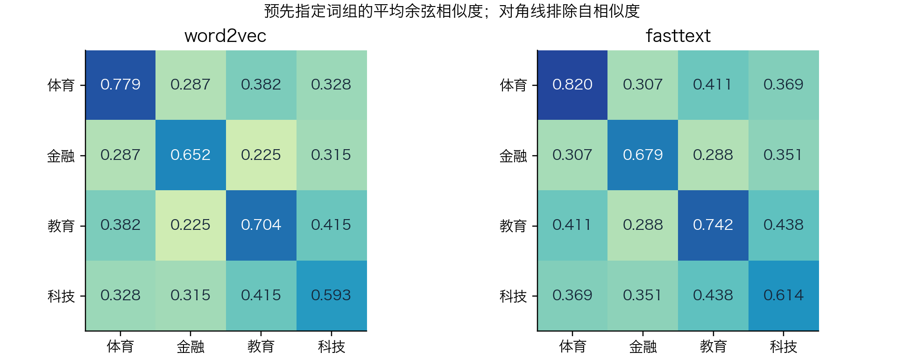
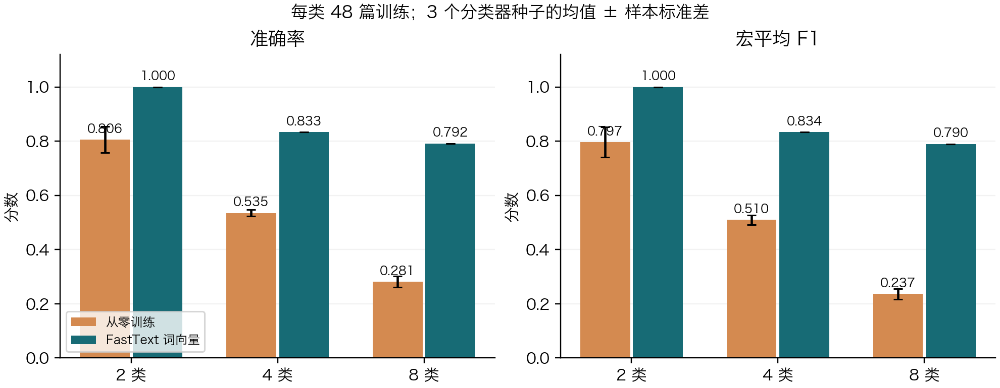
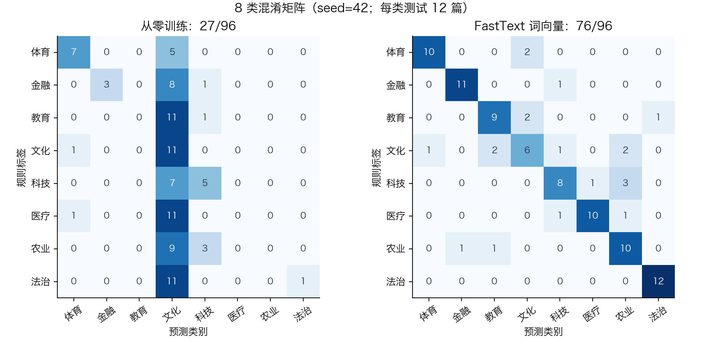
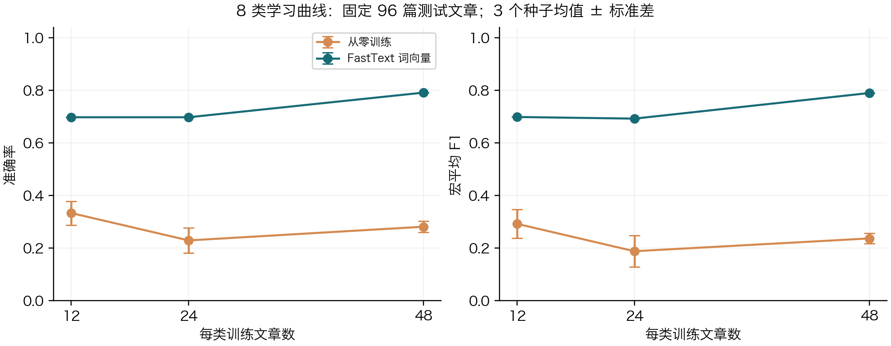

# Gensim 词表示学习与 fastText 文本分类

编程作业实验报告 | 实测日期：2026-10-07 | 所有数值由本次运行的 JSON 和逐篇预测生成。

GitHub 仓库：[https://github.com/JennyMa11/hw2-gensim-fasttext](https://github.com/JennyMa11/hw2-gensim-fasttext)

## 1. 实验目标与方法

本实验比较 Word2Vec 与 FastText 的中文词表示，并检验预训练向量对小样本文本分类的作用。基础部分完成近邻、词表外查询、词组余弦分析，以及嵌套的 2／4／8 类监督分类；扩展部分比较 Word2Vec 初始化，并绘制训练样本数的学习曲线。

Word2Vec 为词表内的每个词学习向量；skip-gram 根据中心词预测周围词。本次使用负采样，以真实上下文为正例、按词频的 0.75 次幂采样的词为负例。窗口上限为 5，有效窗口随机缩小，高频词下采样阈值为 0.001。

FastText 在词向量之外学习字符 n-gram 向量，同一字符片段会参与多个词的表示。这样能为未进入词表的词合成向量，也可能过度强调字面相似。近邻与余弦只反映语料统计结构，不能直接等同于词义正确性。

Gensim FastText 负责无监督词向量学习；分类使用官方 fastText 的 train_supervised。导出的 .vec 仅含已合成的词表内向量，没有迁移 Gensim 的字符桶参数。分类器再用带标签正文训练 softmax，所有导入向量都可以继续更新。

## 共同表示学习参数

| 设置 | 取值 |
| --- | --- |
| 算法／维度 | skip-gram／100 |
| 窗口／最低频次／轮次 | 5／3／5 |
| 负采样／下采样 | 5 个负例；ns_exponent=0.75；sample=0.001 |
| 可复现设置 | seed=42；workers=1；PYTHONHASHSEED=0 |
| FastText 特有设置 | 字符 n-gram 长度 2-4；bucket=200000 |

实现依据：Mikolov 等（2013）、Bojanowski 等（2017）、Joulin 等（2017）；文末列出论文和官方文档。实验独立编写并实际执行，没有沿用参考作业中的预测或分数。


---

# 2. 语料、标签与防泄漏划分

采用 PeopleDaily1998 公开镜像中的 199801.zip。包内实际包含 1998 年 1-6 月，不按文件名推断月份。与题目示例的 THUCNews 设置不同，本实验用人民日报完成两个阶段，并在词向量训练前排除全部分类测试文章。

| 处理项目 | 本次统计 |
| --- | --- |
| 恢复文章数 | 18,647 |
| 正文不足 30 词／重复正文 | 2,620／1 |
| 保留的非重复文章 | 16,026 |
| 预训练排除／实际使用文章 | 96／15,930 |
| 表示学习句子／词次 | 289,418／6,007,865 |
| 原始词表／min_count=3 后 | 136,907／58,854 |

以编号的日期、版面、文章序号恢复文章；001 行作为标题，其后作为正文。去掉编号、词性、标点和实体边界，保留复合实体内部现成的分词，不再用 jieba。按句末标点分句，舍弃不足 3 词的片段。1,334 个多斜杠词元按首个词性分隔符处理；唯一空词 /m 被丢弃。

语料没有主题金标签。使用公开在 common.py 的标题关键词生成弱标签：只接受命中一个主题、标题长 4-80 字且正文不少于 80 词的文章。跨主题候选共 164 篇被排除。未对全部样本做人工金标准标注。分类输入去掉标题，仅保留正文前 500 词。

| 类别 | 可用候选 | 训练／测试 |
| --- | --- | --- |
| 体育 | 340 | 48／12 |
| 金融 | 386 | 48／12 |
| 教育 | 290 | 48／12 |
| 文化 | 321 | 48／12 |
| 科技 | 308 | 48／12 |
| 医疗 | 116 | 48／12 |
| 农业 | 340 | 48／12 |
| 法治 | 215 | 48／12 |

每类按 SHA256(sample42:文章ID) 排序取前 60 篇，再按 SHA256(split42:文章ID) 排序取前 12 篇为测试。2 类为体育、金融；4 类再加教育、文化；8 类再加科技、医疗、农业、法治。三套实验沿用相同文章和划分，样本 ID、标题、命中词与正文哈希均在 sample_manifest.csv。


---

# 3. 近邻与词表外查询

两个模型最终词表均为 58,854 词。Apple M5、16 GB 内存环境中，Word2Vec 本次构建词表并训练耗时 83.5 秒，FastText 为 97.1 秒；不含保存、导出与首次导入库的时间。单机单次耗时不代表通用速度排名。

| 词（语料频次） | Word2Vec 前三近邻 | FastText 前三近邻 |
| --- | --- | --- |
| 银行（4350） | 行长 0.791；分行 0.786；商业 0.780 | 银行卡 0.838；非银行 0.827；中小银行 0.816 |
| 学校（1822） | 校外 0.802；师范 0.794；幼儿园 0.785 | 小学校 0.887；校校 0.887；盲校 0.875 |
| 电脑（772） | 计算机 0.815；终端 0.768；寻呼机 0.766 | 寻呼机 0.837；微电脑 0.832；计算机 0.828 |
| 经济（16279） | 国民经济 0.794；全球化 0.716；经济基础 0.704 | 非经济 0.849；非国有经济 0.834；经济体 0.830 |
| 足球（597） | 篮球 0.798；排球 0.783；田径 0.781 | 棒球 0.848；篮球 0.842；踢球 0.833 |
| 计算机（640） | 软件 0.822；微机 0.822；电脑 0.815 | 计算机网 0.941；计算机业 0.885；计算机房 0.874 |

近邻既受上下文影响，也受分词、频次和子词共享影响。FastText 更容易产生共享连续汉字的邻居；这是一种表示机制，不足以证明语义总体更好。完整 top-5 近邻及余弦数值保存在 embedding_analysis.json。

## 词表外（OOV）查询

| 查询词 | 训练频次／词表内 | Word2Vec | FastText 前三近邻 |
| --- | --- | --- | --- |
| 足球运动员 | 0／False | KeyError | 运动员 0.913；教练员 0.839；乒乓球队 0.820 |
| 量子计算芯片 | 0／False | KeyError | ＣＡＭ 0.882；ＤＷＥＭＳ 0.874；ＩＮＤ 0.872 |
| 经济全球化 | 0／False | KeyError | 全球化 0.928；经济体 0.874；经济域 0.868 |

以上构造词的词表状态通过 key_to_index 判断，而非用 FastText 的 “word in wv” 判断。后者可能因为可以合成 OOV 向量而返回真。Word2Vec 对词表外词抛 KeyError；FastText 能返回有限的 100 维向量，但没有直接见过完整词，其近邻也不等于人工语义验证。


---

# 4. 组内／组间相似度与实现核对

| 预先指定词组 | 词语 |
| --- | --- |
| 体育 | 足球、篮球、排球、网球 |
| 金融 | 银行、贷款、利率、证券 |
| 教育 | 学校、教师、学生、教学 |
| 科技 | 计算机、软件、科技、科研 |

所有 16 个词在两个模型的词表中。每组 4 个词，组内取不重复且不含自身的 6 对，四组合计 24 对；跨组每两组 16 对，合计 96 对。计算各词对余弦后平均，不先对词向量求均值。词组在模型结果生成前写入实验配置，未按结果调整。

| 模型 | 组内均值 | 跨组均值 | 两者差值 |
| --- | --- | --- | --- |
| word2vec | 0.6817 | 0.3255 | 0.3562 |
| fasttext | 0.7138 | 0.3605 | 0.3533 |

图 1：各组平均余弦；对角线为组内不同词，非对角线为跨组。



解释时应同时看组内与跨组值：如果两者同时升高，仅凭组内值不能断言分类边界更清晰。这 16 个词属于小规模诊断，没有人工相似度标注，不能代替标准词义评测，也不能据此预判下游准确率。

## 直接复算 Gensim 的已保存向量

词表内表示 =（词行向量 + 所有字符桶行向量之和）／（字符片段数 + 1）；OOV 表示 = 字符桶行向量的平均值。按照 ft_ngram_hashes 得到的桶索引独立求和，核对足球、计算机及上述 3 个 OOV 词。最大分量误差为 0.00e+00，全部通过 1e-5 阈值。该核对验证向量组合公式，没有独立重写并验证哈希函数。


---

# 5. 文本分类：有无预训练向量

分类器统一设置：dim=100、lr=0.3、epoch=25、wordNgrams=2、loss=softmax、thread=1、bucket=200000、minn=maxn=0。分类器平均聚合词及词二元组特征，再学习类别权重。基础对照只改变 pretrainedVectors；其他数据、顺序和超参数一致。所有超参数在测试结果产生前固定，没有按测试集调参。

| 类别数／训练／测试 | 从零：准确率／宏 F1 | FastText 初始化：准确率／宏 F1 |
| --- | --- | --- |
| 2／96／24 | 0.833 / 0.829 | 1.000 / 1.000 |
| 4／192／48 | 0.521 / 0.490 | 0.833 / 0.834 |
| 8／384／96 | 0.281 / 0.242 | 0.792 / 0.790 |

上表为 seed=42。准确率是预测正确文章数除以测试文章数；宏 F1 先逐类计算 2PR／(P+R)，再对类别等权平均，无预测或分母为零时记 0。平衡测试集的多数类基线分别为 0.500、0.250、0.125。

图 2：seed=42、43、44 的均值和样本标准差；固定训练／测试划分。



| 类别数 | 从零：宏 F1 均值 ± SD | FastText：宏 F1 均值 ± SD |
| --- | --- | --- |
| 2 | 0.797 ± 0.055 | 1.000 ± 0.000 |
| 4 | 0.510 ± 0.017 | 0.834 ± 0.000 |
| 8 | 0.237 ± 0.020 | 0.790 ± 0.000 |

8 类 seed=42 时，预训练为 76/96，从零为 27/96，相差 49 篇。配对 bootstrap（10,000 次）准确率差的 95% 区间为 [0.385, 0.635]。区间条件于这批弱标签和固定模型，不反映标签正确性、划分不确定性或跨语料泛化。


---

# 6. 混淆矩阵与逐类表现

图 3：行是标题规则标签，列是模型预测；两图使用同一批 96 篇正文。



| 类别 | 从零 F1 | FastText F1 | FastText 正确／测试 |
| --- | --- | --- | --- |
| 体育 | 0.667 | 0.870 | 10/12 |
| 金融 | 0.400 | 0.917 | 11/12 |
| 教育 | 0.000 | 0.750 | 9/12 |
| 文化 | 0.259 | 0.545 | 6/12 |
| 科技 | 0.455 | 0.696 | 8/12 |
| 医疗 | 0.000 | 0.870 | 10/12 |
| 农业 | 0.000 | 0.714 | 10/12 |
| 法治 | 0.154 | 0.960 | 12/12 |

预训练模型最常见的非对角项：科技→农业：3 篇；文化→教育：2 篇；文化→农业：2 篇；教育→文化：2 篇。每类仅 12 篇测试文章，一篇就影响本类召回率约 8.3 个百分点，因此逐类数值不宜过度解释。

同样 seed=42 再训练一次 8 类预训练分类器，全部 96 篇的预测标签与原运行一致。另两个种子改变的是分类优化随机性；词向量预训练及文章划分保持固定，因此三次运行的标准差不能解释为整个实验的总体误差。


---

# 7. 错误分析与弱标签边界

8 类预训练模型相对规则标签共错 20 篇。下表展示置信度较高的前 6 篇错误；置信度只是模型 softmax 输出，不是经过校准的正确概率。标题仅用于事后分析，不输入分类器。

| 文章 ID | 规则→预测 | 标题 |
| --- | --- | --- |
| 19980608-03-002 | 教育→法治 | 弘扬正气查找问题浙江政法队伍教育整顿动真格 |
| 19980601-05-014 | 教育→文化 | 中学生百科全书赠送贫困县中学 |
| 19980413-07-010 | 医疗→科技 | 美国大力开发生物工程药品 |
| 19980505-04-015 | 文化→体育 | 长春电影节将于八月举行 |
| 19980125-03-003 | 文化→教育 | 文化部『三讲』促进组织建设 |
| 19980528-02-002 | 科技→农业 | 推出科技兴农新举措财政部百县农技推广示范见成效 |

## 正文证据

| 文章 ID | 正文含规则类别关键词 | 正文含预测类别关键词 |
| --- | --- | --- |
| 19980608-03-002 | 教育 | 法院、检察、公安、刑事、民警 |
| 19980601-05-014 | 教育、中学 | 文化 |
| 19980413-07-010 | 药品、疾病 | 未命中 |
| 19980505-04-015 | 电影 | 未命中 |

这些词仅作为透明的诊断线索，不是模型归因，也不能证明预测标签更正确。新闻正文可以同时涉及政策、机构、技术与具体行业，单一类别规则会压缩真实主题。case study 分析的是“与规则标签不一致”，不能把每一处都认定为语义错误。

## 筛选阶段已经存在的边界例子

19980529-08-005 的标题包含“北京大学登山队”，因“大学”被标成教育，但也可从体育角度理解；19980528-02-002 涉及“科技兴农”，标题规则给科技，正文也可能包含农业。即使排除了同时命中多个主题关键词的标题，跨领域报道依然存在。此处如实保留弱标签，不在看到模型错误后改标或删除测试文章。


---

# 8. 扩展：初始化类型与训练规模

## Word2Vec 初始化对照（8 类）

| 初始化 | seed=42 准确率／宏 F1 | 3 种子宏 F1 均值 ± SD |
| --- | --- | --- |
| scratch | 0.281 / 0.242 | 0.237 ± 0.020 |
| word2vec | 0.792 / 0.790 | 0.790 ± 0.000 |
| fasttext | 0.792 / 0.790 | 0.790 ± 0.000 |

Word2Vec 与 FastText 使用完全相同的预训练句子、词表门槛、维度和监督训练配置。这个对照比只看词组余弦更直接地检验两种表示对当前分类任务的作用。有限的数据、种子与单一超参数配置，仍不足以建立通用模型排名。

seed=42 时，两种预训练初始化在 96 篇测试文章中有 96 篇标签预测一致，概率最大相差 0.102；两份 .vec 的 SHA-256 不同，预测文件独立生成。结合三个种子的结果，本实验不足以证明 FastText 初始化有稳定的最终精度优势。

## 嵌套小样本学习曲线（8 类）

图 4：每类训练 12、24、48 篇；测试始终为同一批 96 篇。



| 每类训练／总训练 | 从零：宏 F1 均值 ± SD | FastText：宏 F1 均值 ± SD |
| --- | --- | --- |
| 12／96 | 0.292 ± 0.055 | 0.699 ± 0.000 |
| 24／192 | 0.188 ± 0.060 | 0.693 ± 0.000 |
| 48／384 | 0.237 ± 0.020 | 0.790 ± 0.000 |

小训练集按 SHA256(learning42:文章ID) 排序截取，是 48 篇集合的嵌套子集。这里仅缩减监督样本数：词向量使用的无标签语料保持不变，且其中含有未进入小训练子集的非测试文章。因此曲线衡量固定无标签资源下的标注样本效率，不是预训练语料规模 scaling 实验。


---

# 9. 追加诊断：从零训练是否收敛不足

在查看主实验后，从零训练的低分引出了优化轮次不足的可能。于是增加了 100 和 200 轮的诊断：两种初始化使用同一训练／测试集、同一学习率和三个种子，只改变轮次。此项属于事后敏感性分析；不替换 25 轮主表，也不据测试分数选择“最优模型”。若要选择超参数，仍需要另设验证集。

| 轮次 | 从零：准确率／宏 F1 均值 | FastText：准确率／宏 F1 均值 |
| --- | --- | --- |
| 25 | 0.281 / 0.237 | 0.792 / 0.790 |
| 100 | 0.823 / 0.825 | 0.823 / 0.823 |
| 200 | 0.861 / 0.862 | 0.823 / 0.823 |

| 轮次 | 从零：宏 F1 均值 ± SD | FastText：宏 F1 均值 ± SD |
| --- | --- | --- |
| 25 | 0.237 ± 0.020 | 0.790 ± 0.000 |
| 100 | 0.825 ± 0.001 | 0.823 ± 0.000 |
| 200 | 0.862 ± 0.007 | 0.823 ± 0.000 |

从零训练增加轮次后恢复了大部分表现，说明 25 轮主表中的巨大差距包含收敛速度与优化预算的影响。因而不能把它全部解释为从零训练最终能力的上限，也不能声称预训练在充分训练后必然更准确。相同轮次并不意味着两种初始化都已经充分收敛。

这项诊断也解释了为什么不能只提交一个高分表：预训练表示同时影响初始化位置、收敛速度和有限标注下的优化。学习曲线固定 25 轮，因而同样应理解为固定训练预算下的样本效率。更严格的对照会为各方法分别在独立验证集上选择学习率与轮次，再仅一次评估独立测试集。

各次轮次诊断的指标与 1,152 条逐篇预测保存在 epoch_diagnostic.json，准确率和宏 F1 均已从预测重新核验。主实验 34 次训练、扩展诊断新增 12 次训练，共实际执行 46 次监督模型训练。


---

# 10. 结论、局限与复现

固定 25 轮时，8 类 FastText 初始化的宏 F1 三种子均值为 0.790，从零训练为 0.237，差为 0.553。该结果支持预训练在当前优化预算下的价值。追加的 100／200 轮诊断显示从零训练大幅改善，因此结论应限定于训练预算，不能宣称预训练有普遍的最终精度优势。

预训练词表覆盖实际分类正文的训练词次 98.26%、测试词次 97.60%；测试词型覆盖 91.61%。分类阶段关闭字符子词，所以 Gensim 的 OOV 合成能力并没有通过 .vec 一并迁移。官方 fastText 载入预训练文件还会扩充分类词典，字典大小记录在每次运行结果中；这属于通常的预训练导入机制，不能解释成只替换固定词典中的矩阵。

局限：标题关键词产生选择偏差与标签噪声；仅 96 篇固定测试样本；未做全量人工标注、跨年份验证或多次独立划分；标题按 001 行近似界定，另行副标题可能留在正文；正文前 500 词会截断信息；完全正文去重未排除近重复报道；两阶段共享同领域的非测试文章。后续可扩充人工标签，加入验证集、多划分统计与跨领域测试，并在相同协议下比较 Doc2Vec 或词向量平均池化分类器。

## 复现与验证

自动核验状态：PASS。已重算 34 次训练的全部准确率、宏 F1 和混淆矩阵，核对 2,544 条逐篇预测，并检查正文哈希、测试文章排除以及类别／训练规模嵌套关系。

```bash
python3.12 -m venv .venv
source .venv/bin/activate
pip install -r requirements-lock.txt
bash run_all.sh
```

源 ZIP SHA-256：17474bbf2b360921f2eae0089fd83e22601e5a0649943c3f59403650997b4ed2

源仓库固定 commit：4020ecc558c554c6f3c9bd81a606d2197e28e628。环境为 Python 3.12.14、Gensim 4.3.3、fasttext-wheel 0.9.2（导入 fasttext）、NumPy 1.26.4、SciPy 1.13.1、scikit-learn 1.5.2。跨平台编译器与浮点实现可能影响末位数值。轻量提交包不含原始全文与大型模型，脚本会下载校验语料并重建。

## 参考资料

- [数据镜像与标注说明](https://github.com/chenhui-bupt/PeopleDaily1998)
- [Mikolov et al., 2013. Efficient Estimation of Word Representations](https://arxiv.org/abs/1301.3781)
- [Bojanowski et al., 2017. Enriching Word Vectors with Subword Information](https://aclanthology.org/Q17-1010/)
- [Joulin et al., 2017. Bag of Tricks for Efficient Text Classification](https://aclanthology.org/E17-2068/)
- [Gensim FastText 官方文档](https://radimrehurek.com/gensim/models/fasttext.html)
- [官方 fastText Python 接口](https://fasttext.cc/docs/en/python-module.html)